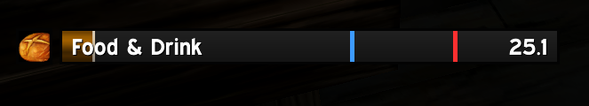

# BiscuitBreak

Use your strongest food and drink with one macro. The recovery bar turns green when the resources they restore are full.

Open the General tab of `/macro` and drag `_BB_Meal` to an action bar. BiscuitBreak overwrites any existing General macro with that name. `/bb` or the minimap button opens the settings.

- Picks again when your bags or your level change
- Skips items above your level
- Marks estimated health and mana refill times on one countdown

The macro updates after combat, because the game blocks macro edits during a fight. A deleted `_BB_Meal` comes back on the next bag change unless you turn off "Update the macro" in the settings.

For World of Warcraft Forever.

## Install

Get it on [CurseForge](https://www.curseforge.com/wow/addons/biscuitbreak) or [Wago](https://addons.wago.io/addons/bGoYVJ60), or download the zip from [GitHub releases](https://github.com/byteorem/BiscuitBreak/releases).

Feedback and bug reports are welcome on [GitHub](https://github.com/byteorem/BiscuitBreak/issues).
